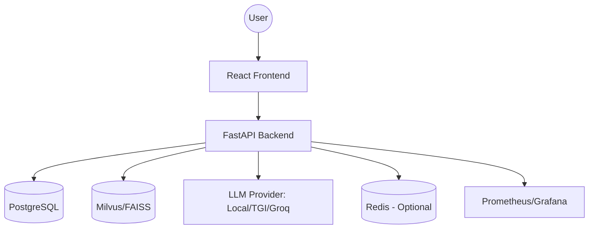

# System Architecture

This document describes the high-level architecture of the Personal AI Assistant.

## Overview

The system is a decoupled client-server application designed for modularity and scalability. It consists of a React frontend, a FastAPI backend, and a set of infrastructure services (PostgreSQL, Milvus, Redis).

## Component Diagram

## Component Details

### 1. Frontend (React + Vite + TS)
- **Role**: User interface for chatting with the AI assistant.
- **Tech Stack**: React, TypeScript, Tailwind CSS, Vite.
- **Key Features**: Session management, real-time chat interface, responsive design.

### 2. Backend (FastAPI)
- **Role**: Orchestrates the AI logic, manages users/sessions, and handles data retrieval.
- **Layered Architecture**:
    - `app/main.py`: API Gateway and routing.
    - `app/services/`: Core business logic (LLM client, RAG pipeline).
    - `app/crud/`: Data access layer for PostgreSQL.
    - `app/models/`: SQLAlchemy ORM models.
    - `app/core/`: Configuration, security, and logging.
- **Key Capabilities**:
    - **JWT Authentication**: Secure user access.
    - **RAG Pipeline**: Retrieves relevant documents from the vector store to augment LLM prompts.
    - **LLM Agnostic**: Supports multiple LLM backends via a unified client.

### 3. Data Storage
- **PostgreSQL**: Stores relational data such as user profiles and chat session metadata.
- **Milvus/FAISS**: Vector database for storing and searching document embeddings.
- **Redis**: (Optional) Used for caching and potentially as a message broker for asynchronous tasks.

### 4. Telemetry & Monitoring
- **Prometheus**: Collects system and application metrics (e.g., request counts, LLM latency).
- **Grafana**: Visualizes metrics for system health monitoring.

## Data Flow: Chat Request
1. **User** sends a prompt via the **Frontend**.
2. **Backend** receives the request and authenticates the user via JWT.
3. **RAG Service** generates an embedding for the prompt and queries **Milvus** for relevant document chunks.
4. **LLM Client** constructs a prompt combining the original query and retrieved context.
5. **LLM Provider** generates the final response.
6. **Backend** returns the response to the **Frontend**.
